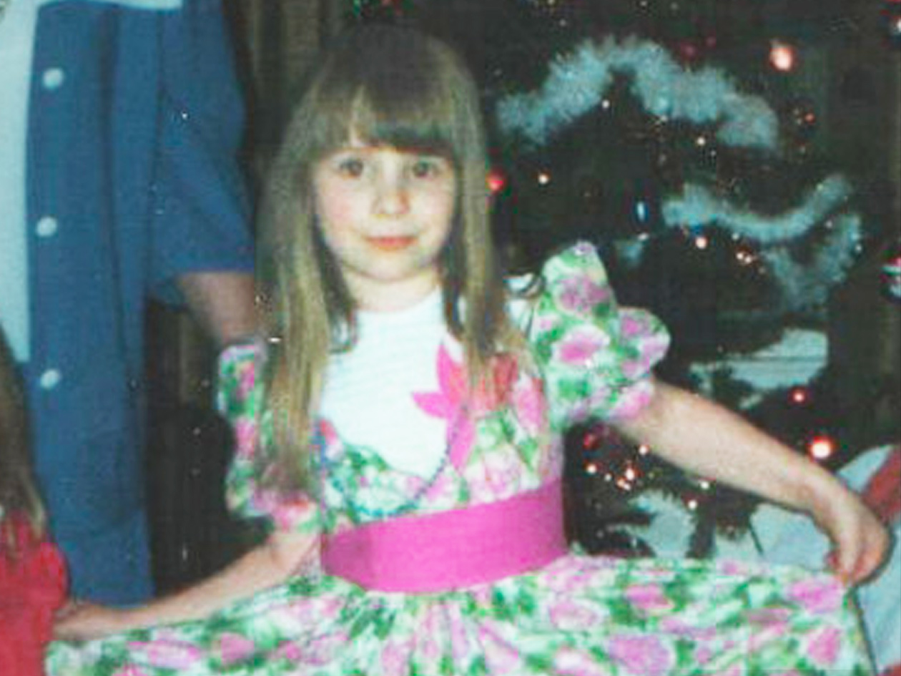

These four little words cast a magic spell. They hold the power to transport us to a fairytale realm; a place that exists outside of temporal reality. A world that is as much 'now' as it is 'then' and evermore.

In this land we are no longer specific and complex individuals. Instead, we find all our traits and emotional states reflected in an ensemble cast of stock characters: the plucky peasant, the arrogant prince or the vengeful, jealous stepmother. And there, on the fringes of our consciousness, we live on the verge of wild woods; where beasts of unknown violence and savage desires lurk in the shadows.

This archetypal foreverworld is where we find *the princess*. A girl poised on the brink of womanhood, whose virtue is expressed through her beauty, kind nature and dreams of love. We know the princess as we know the most gentle and sensitive parts of our own nature. Hopeful and naive, this child's blessed ignorance is bound by fate to face down the enchanted darkness of the adult world.

So with what arrogance, you may ask, do I declare this fledgling blog series 'The (Lost) Princess Diaries'? I can only say that I invoke the princess and her story with deference and fascination. From the very start of my artistic journey around 25 years ago, I've looked to explore the narratives of femininity. And, like all us girls of the millennial generation, I was raised in a princess culture. Toys, books, movies; Princess Diana; then later the phenomenon of the 'pop-princess', who symbolised a burgeoning sexuality still tinted with the pastel colour palette of childhood. We were *socially groomed* to try and embody her. And, perhaps, there was nothing wrong with that?!  

*The writer of this blog in 1993.*

---

For the princess has powers, she is a heroic character. Contemporary interpretations may overlook this: Reading passivity in the fact that she's not a physical fighter; seeing weakness in her inability to escape from jeopardy all alone. That's not to mention the troubled concept of 'royal blood', an inherited *specialness* or ascendancy that this female heir possesses, but is invariably exiled from or kept in the dark about.

Though when the cynic says 'life is no fairytale' to imply that there is no such thing as happy endings, they forget the grim (Grimm?) circumstances that occur on the way to ever after. The princess' strength comes from her fortitude and persistently innocent perspective, even in the face of great hardship and injustice. Though reduced to the lowliest status as servant or hostage; betrayed by the machinations of manipulative witches and feeble father-kings, she endures her ill-treatment, enslavement or curse while somehow maintaining a pure heart. A heart that hopes.

And it is hope and belief; in magic, fairies, the goodness of forest creatures etc; that create the conditions for her rescue. In her darkest hour, she takes the assistance that is offered, and in the end she allows herself to be saved. Needing help to overturn the sinister forces in our lives can feel difficult to accept for the post-modern princess, but without faith that good really does exist, both in the world and in our own hearts, it would seem that we truly are lost.

I meant this first blog piece as an introduction to my new website, but seem to have been pulled off track, into the wilderness of meaning that surrounds the creative process itself. At it's core, the Princess story is a dream of transcendence: To go beyond the drudgery, disrespect and quiet suffering of everyday; to see the dark forest and fearsome creatures that live within, yet be delivered from them unscathed; to have felt the rule of power and cruelty levelled against us but not to become cruel ourselves; finally ascending to the sanctuary of a beautiful castle in the sky.

This dream of transcendence, so far as I see it, is also profoundly the dream of art. A spiritual call of truth and beauty that can protect our hearts, whatever we are called upon to endure. But while the archetype of the princess lives within all of us, so too does her jailor and tormentor: The wicked queen, Rumplestiltzkin. If we are not honest in our self-reflection, we may find these more twisted entities making efforts to possess us. And if contemporary re-workings of the old tales have added anything to the canon, it is this: Evil does not always start out that way.

When we are hurt by this world, we can easily find bitterness creeping upon us, turning our actions into vengeful manipulations as we seek to right the (still rankling) wrongs of the past. We might be easily stirred by rage or sink into self-pity and apathy. Or, most dreadfully, we may take warped pleasure in doing to others the very worst that has been done to us; evading responsibility through contortions of the ego whilst conjuring and perpetuating the same old demons.

But our story is never over until 'The End'.

Somewhere between being banished from her birthright and accepting the universal gift of transcendence, the (lost) princess fumbles her way down the path towards self-expression; bordered on both sides by unilluminated terrain and tangled roots. Having evaded her former captivity, and with none of the narrator's knowledge of her sovereign lineage, she feels herself to have no place in society. Alone and disoriented, with no miraculous salvation on the horizon, she finds herself running again from wilder side of nature, coming to understand that escape and exile are two sides of the same coin.

And that, my dear patient reader, is why I call this blog 'The (Lost) Princess Diaries'. Not simply as a play on a noughties teen movie title (although I do like to pay tribute to the era and aesthetics that shaped me!); I am writing here to discuss the circuitous journey of creation and the (at times) perilous process of finding your own voice.

For the moment, that is all I will write - as I'm really quite desperate to get this website launched after working on it for over six months 😅. But if you made it to here then thank you for reading - it feels good to express some of these thoughts - and how will we ever discover our true voice until we (at least) try to speak?
